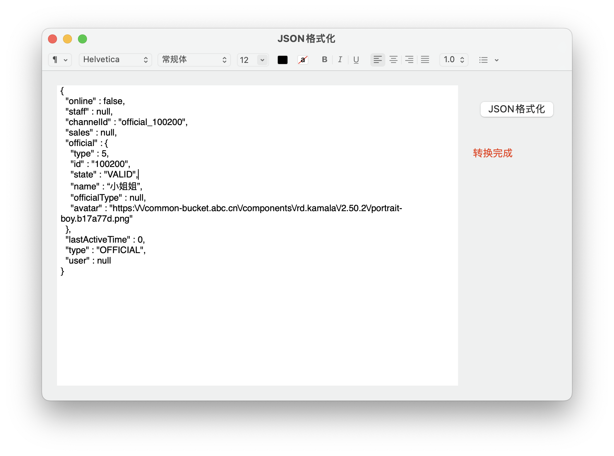
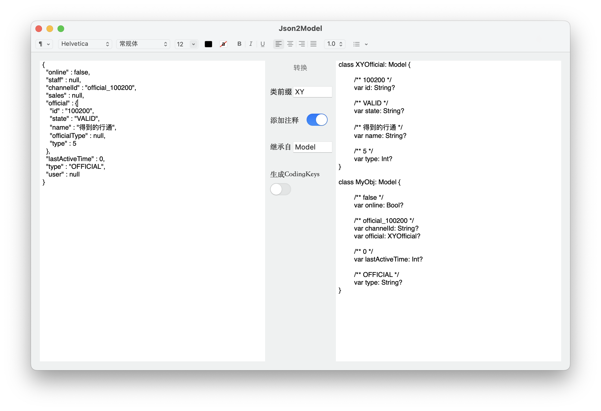
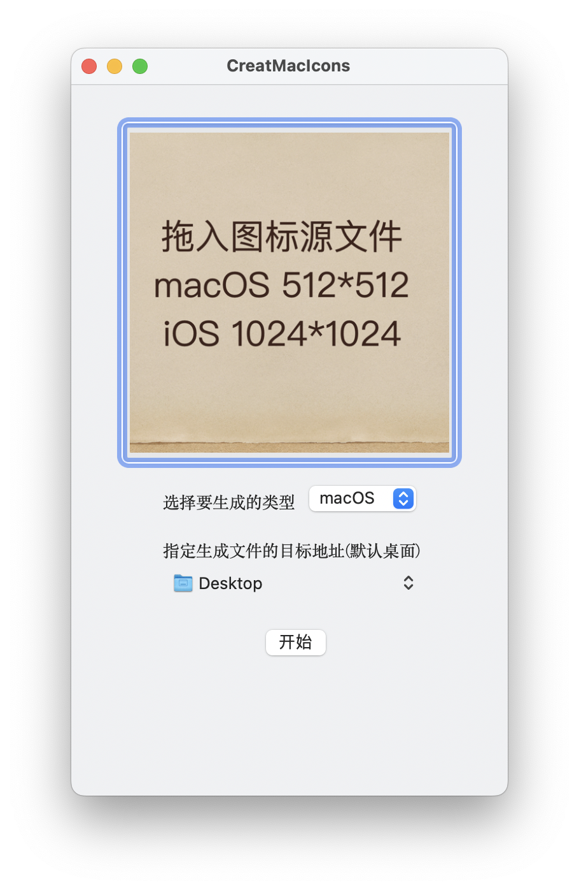
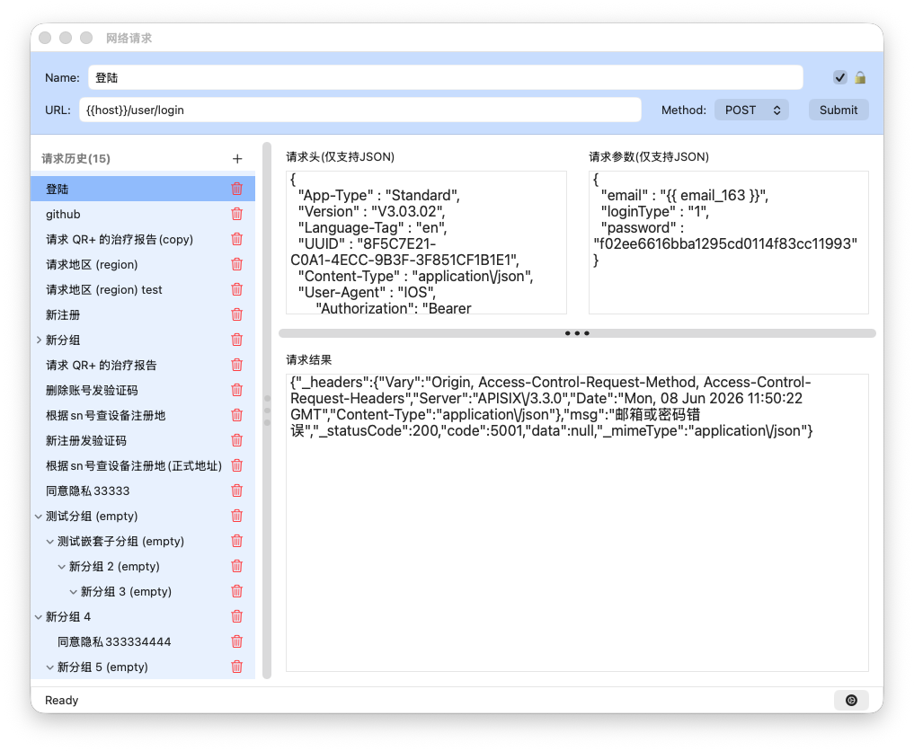

English | [简体中文](./README.zh-CN.md)

DevTool
============

A simple UI and powerful Mac OS application. It is a collection of tools commonly used in my development work. It is open source and hopes to help people in need. At present, its main functions are as follows

- JSON formatting tool: used to quickly format network JSON data into formatted JSON for easy reading

- JSON to model: read JSON data and generate swift model. It supports a variety of configuration options, especially for complex JSON parsing, which fully liberates both hands

- Appicon generator: supports the generation of IOS / MacOS app icons, one click generation and export to the specified directory

- Network request tool: A lightweight, local HTTP client inspired by Postman. Supports GET/POST/PUT, tree-organized history with groups, variable substitution, and pre/post scripts. History and configs stay on your Mac and can be exported/imported as a bundle.

- QRCode: Generate and decode common static QR codes locally (Text / URL / WiFi / Email / SMS / Phone / vCard / App Link / Event), with preview, copy, PNG export, and image recognition

- Runtime logs: Inspect local app logs from the Help menu, filter by module/level; network-related logs are privacy-filtered and stay on your Mac

- ...

Functions & Features
========

JSONFormat
-----

- Format the JSON string returned by the interface into a format that is easy to read and understand
- ...

JSON to Model
-----

- Automatically convert JSON files to swift class to reduce repetitive work and error probability
- Automatically resolve nested types array and dictionary, and resolve the contents of nested types into new classes according to the actual situation
- For the array type, the complete key value of the dict element is automatically parsed to effectively avoid the possible loss caused by the random writing / less writing of the array element key in the test JSON test data
- Support custom class prefix
- Support custom class, inherit base class and abide by protocol
- It supports setting the value of the original JSON to the attribute annotation, which is convenient for viewing the code during subsequent maintenance
- It supports the automatic generation of codingkeys to facilitate the subsequent direct use of the system codable protocol for model transformation
- ...

Appicon generator
-----

- The user passes in the specified picture and generates IOS / MacOS appicon with one click. It is suitable for individual developers to quickly generate icons for personal projects (the icon of this project is generated from this, and this function is also generated because of the icon generated by this project)
- ...

Network request tool
-----

A lightweight, local HTTP client for day-to-day API debugging: history / variables / scripts stay on your Mac with no account or cloud sync. Sending a request still requires reaching the target API.

**Send requests**

- Set name, URL, GET/POST/PUT; headers and parameters are JSON (may be empty), then Submit
- For GET, “parameters” become URL query items; for POST / PUT they are the JSON body (adds `Content-Type: application/json` when missing)
- If name is empty, the URL host is used as the request name
- The **same name** updates an existing entry **globally** (across groups); a **new name** creates a history item
- When a **group** is selected, new requests are added under that group; otherwise they are added at the root

**History (tree)**

- Left sidebar shows request history in a **multi-level group tree** with expand/collapse
- Click a request to load it into the editor; select a group to create sub-groups or target new requests
- Toolbar **+**: creates a sub-group under the selected group, or a root-level group otherwise
- **Drag entire rows** to reorder siblings, move into/out of groups, or reparent across levels (the delete button does not start a drag)
- Groups: double-click or right-click to rename; delete with “unwrap only” or “delete group and contents”
- Requests: delete from the row trash icon. Lock is the **🔒 toggle next to Name** (on by default); unlock before deleting. Deleting a group “with contents” may ask to force-delete locked items

**Variables & scripts** (⚙️ in the status bar)

- **Variables**: use `{{key}}` in URL, headers, and body; substituted before send; preview resolved values in Settings
- **Global pre-request scripts**: rewrite / sign / proxy the request before send; select a history item first, then bind one script
- **Global post-response scripts**: run shell commands after a response; output can update variables (`$1` = response text, `$2` = variables JSON); multi-select per request
- **Binding prerequisite**: a history request must be selected before pre/post scripts can be bound in Settings

**Config backup**

- Export / import a folder with four JSON files: `network_history.json`, `network_variables.json`, `network_global_scripts.json` (post), `network_global_pre_scripts.json` (pre; optional on import—missing clears the pre-script library)

**Notes**

- Headers and parameters must be JSON objects; invalid JSON is blocked
- GET / POST / PUT only (no dedicated status panel); a successful response is a synthesized JSON that often includes `_statusCode` / `_headers`
- Full script protocol and UI details: App Help → Network tool

QRCode
-----

A local QR toolkit—no account or network required.

- Content types: Text, URL, WiFi, Email, SMS, Phone, vCard, App Link, Event
- Options: error correction, quiet zone, export size (256 / 512 / 1024)
- Preview, copy image, copy payload, export PNG; import an image to decode a QR code
- Not yet: color styles, logo embedding, SVG export, history, batch generation

Runtime logs
-----

- **Help → Runtime Logs…** opens the viewer; **Reveal Logs in Finder** opens the log directory
- Filter by module/level and search events; long fields are truncated in the panel—full text is in the log files
- Request/response related logs are privacy-filtered and stored only on your Mac

Screenshots
========================

Install
============
- Direct download [Release Packages](https://github.com/xiaoyouPrince/XYDevTool/releases)
- Clone source code, execute build in Xcode, copy XYDevTool.app to Application folder

Others
======
Those functions are frequently used by me, so I wrote them in my App. If you have better suggestions, such as some more functions, please submit PR/Issues, thank you! If you like it, please click a star to encourage me！ 😁

