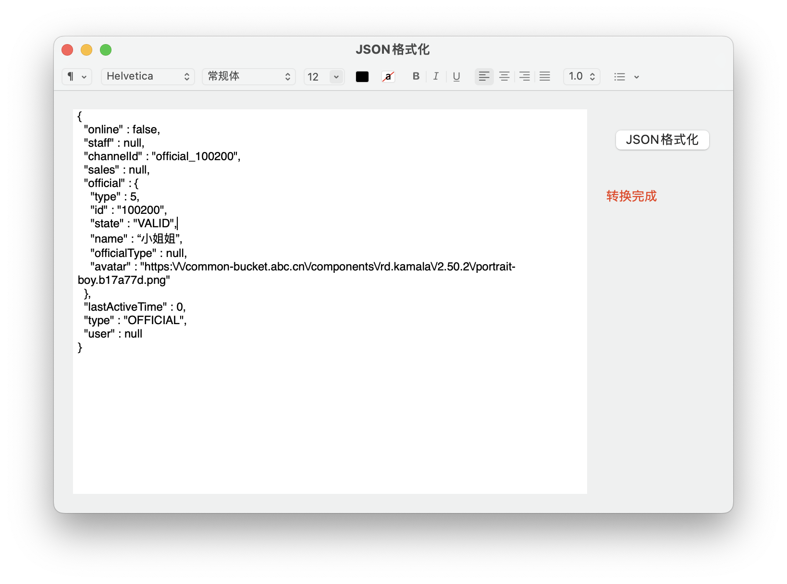
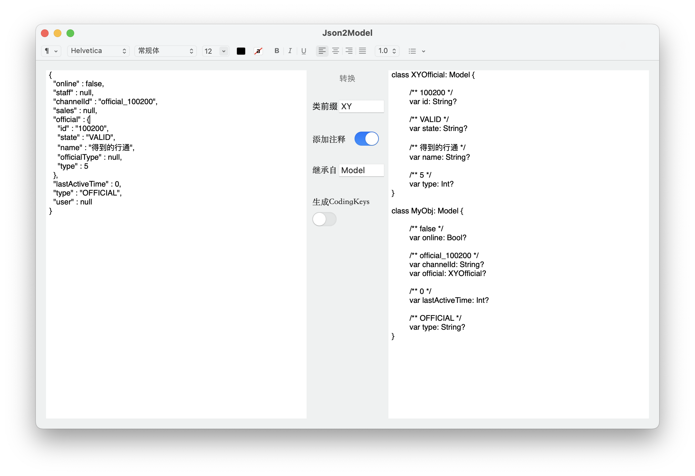
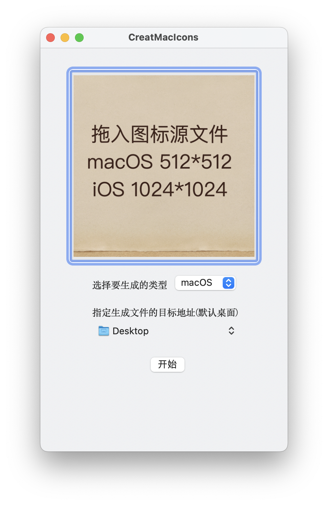
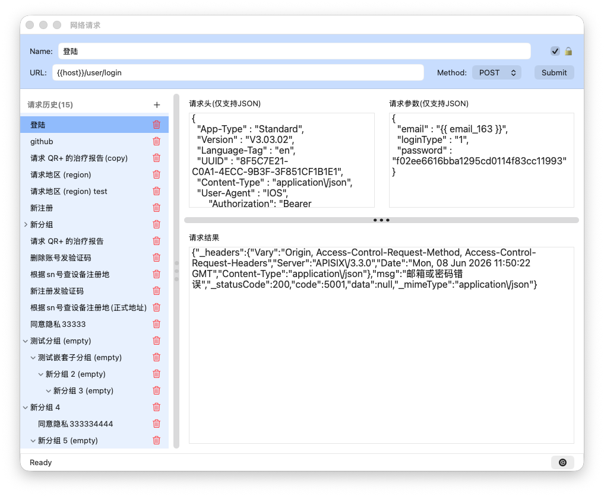

[English](./README.md) | 简体中文

DevTool
============

一款简洁 UI 和功能强大的 macOS 应用程序。它是我开发工作过程中常用工具的集合，开源出来也希望能帮助到有需要的人，目前的主要功能如下

- JSON 格式化工具: 用于快速格式化网络 JSON 数据成为格式化后的 JSON 方便阅读

- JSON 转 Model: 读取 JSON 数据生成 Swift Model，支持多种配置选项，尤其对于复杂 JSON 的解析，充分解放双手

- AppIcon 生成器: 支持生成 iOS/macOS App 图标，一键生成并导出到指定目录

- 网络请求工具: 轻量本地 HTTP 调试工具，参考 Postman 但更简洁。支持 GET/POST/PUT、树形历史分组、变量替换、前置/后置脚本，历史与配置保存在本机，可整套导出/导入，适合前后端接口连调。

- QRCode: 本地生成与识别常见静态二维码（Text / URL / WiFi / Email / SMS / Phone / vCard / App Link / Event），支持预览、复制、导出 PNG 与图片识别

- 运行日志: 通过 Help 菜单查看本机运行日志，支持按模块/级别筛选，网络相关日志经安全过滤后仅存本机

- ...

Functions & Features
========

JSONFormat
-----

- 格式化接口返回的 JSON 字符串，变成易于阅读和理解的格式
- ...

JSON 转 Model
-----

- 自动 JSON 文件转换为 Swift Class，减少重复工作，降低出错概率
- 自动解析嵌套类型 array 和 dictionary，并将嵌套类型的内容按实际解析成新的类
- 对于数组类型自动解析其 dict 元素完整的键值，有效避免测试 Json 测试数据中数组元素key乱写/少写导致可能的丢失情况
- 支持自定义类前缀
- 支持自定义类继承基类 + 遵守协议
- 支持将原来 JSON 的 value 设置为属性注释，方便后续维护的时候查看代码
- 支持自动生成 CodingKeys, 方便后续直接使用系统 Codable 协议进行模型转换
- ...

AppIcon 生成器
-----

- 用户传入指定图片，一键生成 iOS/macOS AppIcon。适合个人开发者做个人项目快速生成图标(本项目图标就由此生成，本功能也是因为本项目生成图标而生)
- ...

网络请求工具
-----

轻量、纯本地的 HTTP 调试工具：历史 / 变量 / 脚本保存在本机，无需账号或云同步；发请求仍需能访问目标接口。

**发请求**

- 填写请求名称、URL，选择 GET / POST / PUT；请求头 / 请求参数填 JSON（可留空），点击 Submit
- GET 的「请求参数」拼到 URL query；POST / PUT 作为 JSON body（缺省会补 `Content-Type: application/json`）
- 请求名称留空时，自动使用 URL 的 host 作为名称
- 同名请求按**全局名称**覆盖已有记录（可跨分组）；不同名称会**新建**一条历史
- 若当前选中的是分组，新建请求会落入该分组；否则落在根级

**历史记录（树形）**

- 左侧以树形展示请求历史，支持**多层分组**、展开/折叠
- 点击请求加载到编辑区；点击分组可选中，用于在其下新建子分组或落点新建请求
- 顶栏「+」：选中分组时在其下新建分组，否则在根级新建
- **整行拖拽**：同层排序、拖入/拖出分组、跨层级移动（点击删除按钮不会触发拖拽）
- 分组：双击或右键可重命名；删除分组时可选择「仅删除分组」或「删除分组及全部内容」
- 请求：行尾删除。锁定开关在**顶栏 Name 旁 🔒**（默认锁定）；须先解锁再删。删组「及内容」遇锁定项会再确认强制删除

**变量与脚本**（底部状态栏 ⚙️ 设置）

- **变量**：在 URL / 请求头 / 请求参数中使用 `{{key}}`，发请求前自动替换；支持嵌套，设置页可预览最终解析结果
- **全局前置脚本**：请求发出前改包 / 签名 / 代发；先选中历史请求再绑定（单选）
- **全局后置脚本**：响应返回后按 Shell 命令执行，可将结果写回变量（`$1` 响应文本、`$2` 变量 JSON）；按请求多选绑定
- **绑定前提**：必须先在左侧选中一条历史请求，设置页才能绑前置/后置
- **Mock 服务**：底栏 **Mock** 可启动本地 HTTP 回放；局域网按 Method+Path 访问历史响应（自动剥离调试字段）

**配置管理**

- 导出 / 导入选择的是目录，包含四份 JSON：`network_history.json`、`network_variables.json`、`network_global_scripts.json`（后置）、`network_global_pre_scripts.json`（前置；导入时可选，缺失则清空前置库）

**说明**

- 请求头、请求参数仅支持 JSON 对象格式；非法 JSON 会拦截
- 支持 GET / POST / PUT（无独立状态码面板）；成功响应为合成 JSON，常含 `_statusCode` / `_headers` 等字段
- 更完整的脚本协议与界面说明见 App Help →「网络请求工具」

QRCode
-----

本地二维码工具，无需账号或联网即可使用。

- 支持 Text、URL、WiFi、Email、SMS、Phone、vCard、App Link、Event
- 可配置容错级别、静区边距、导出尺寸（256 / 512 / 1024）
- 预览后可复制图片、复制原始内容、导出 PNG；也可导入图片识别二维码内容
- 尚未提供：样式颜色、Logo、SVG、历史记录、批量生成

运行日志
-----

- 菜单栏 **Help → 运行日志…** 打开查看窗口；**在 Finder 中显示日志** 可打开日志目录
- 按模块、级别筛选，搜索事件与运行数据；详情过长时面板仅预览，完整内容见日志文件
- 请求与响应相关日志经安全过滤，仅保存在本机

Screenshots
========================

Install
============

- 直接下载 [Release Packages](https://github.com/xiaoyouPrince/XYDevTool/releases)
- 克隆源代码，通过 Xcode 编译, 将编译好的项目 XYDevTool.app 拷贝到 Application 文件夹下

Others
======

这些功能是我经常使用的，所以我在我的应用程序中编写了它们。如果您有更好的建议，如更多功能，请提交 MR/issues，谢谢！如果你喜欢，请点击一颗星星来鼓励我😁

